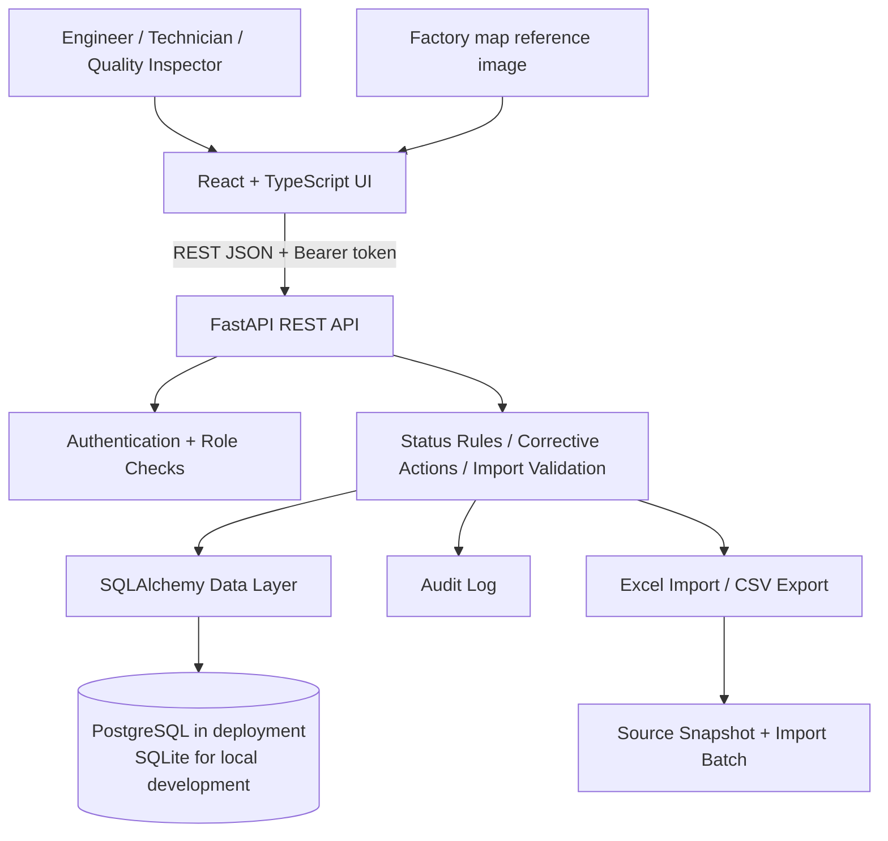

# PO Gun Interactive Monitoring System — MVP

A full-stack prototype built around the supplied `PO_GUN_INTERACTIVE_MONITORING_TEST.xlsm` workbook and its existing register fields. It includes a FastAPI REST API, SQLAlchemy relational data model, role-aware authentication, corrective-action workflow, import/export, audit records, a responsive React/TypeScript interface, and a dependency-free UI fallback served directly by FastAPI.

> **Important production boundary:** this is a tested MVP foundation, not a certified factory-control system. The supplied register does not explicitly state current/pressure units, source readings are labelled September without a year, and verified factory-map marker coordinates are unavailable. These items are preserved as unconfirmed. The application does not change machine settings or claim that recommendations are approved production setpoints.

## Source-data baseline

The bootstrap snapshot was extracted from the workbook's `EQUIPMENT REGISTER` and related sheets. Register counts are:

| Car model | Zone A | Zone B | Total |
|---|---:|---:|---:|
| CITY 4D | 22 | 31 | 53 |
| CITY 5D | 21 | 28 | 49 |
| HR-V | 23 | 28 | 51 |
| WR-V | 23 | 30 | 53 |
| **All models** | **89** | **117** | **206** |

All 206 current records calculate as `OK` using the actual/min/max values present in the workbook. Four existing corrective-action rows are imported as **legacy source rows**; they are not represented as verified current incidents. A separate legacy summary view in the workbook reports 414, which differs from the 206 equipment-register rows. The app's operational KPIs use the equipment register and the dashboard displays this difference in its data-quality notes.

## Architecture



**Technology choices**

- **Frontend:** React, TypeScript, Vite, Recharts, Lucide React. A dependency-free static fallback is included if you only need to start the API without installing frontend packages.
- **Backend:** FastAPI and Pydantic for typed validation, OpenAPI docs, and explicit HTTP errors.
- **Persistence:** SQLAlchemy 2.x with PostgreSQL for deployment and SQLite for quick local evaluation.
- **Security:** PBKDF2 password hashing, signed bearer tokens, role gates, server-side validation, and audit records. Before external deployment, replace every `.env` example secret and configure HTTPS/reverse-proxy controls.
- **Migrations:** Alembic initial schema revision.

## Application modules

- Overview dashboard: model/zone filtering, OK/NG/Unverified KPIs, zone/model comparisons, data-quality notes, abnormal equipment and recent actions.
- Factory map: original map image and process/station directory. Coordinates are configurable and remain marked unverified until approved.
- Equipment register: filtering/search/paging, equipment details, current and pressure status, parameter-entry form, and navigation to process/transformer/PO Gun detail panels.
- Corrective actions: listing/filtering, creation, edits, verification requirements, duplicate-open-action guard, and traceability fields.
- Data import/export: workbook preview, validation, explicit commit, no silent deletion, and CSV export.
- Reports: summary and dated trends. Imported source readings have no confirmed observation date and therefore are not backfilled into historic trend series.
- User/role API: administration endpoints for account management. The React version includes user controls; the minimal fallback UI exposes the monitoring workflows while the user-management endpoints remain available.

## File structure

```text
po-gun-monitoring-mvp/
├── backend/
│   ├── app/
│   │   ├── api/                 # REST endpoint modules
│   │   ├── services/            # bootstrap, status, audit
│   │   ├── static/              # no-build frontend fallback
│   │   ├── config.py
│   │   ├── database.py
│   │   ├── models.py             # normalized SQLAlchemy entities
│   │   ├── schemas.py            # request validation
│   │   ├── security.py
│   │   ├── serializers.py
│   │   └── main.py
│   ├── alembic/                 # database migration history
│   ├── tests/
│   ├── Dockerfile
│   └── requirements.txt
├── data/source_snapshot.json    # extracted source register snapshot
├── docs/                        # architecture, schema, API, data dictionary
├── frontend/
│   ├── public/factory-map-source.png
│   └── src/                     # React + TypeScript client
├── scripts/extract_workbook_snapshot.py
├── .env.example
├── docker-compose.yml
└── README.md
```

## Run locally — backend and fallback interface

Requirements: Python 3.11+ (tested with 3.13 in the authoring environment).

### Windows PowerShell

```powershell
cd po-gun-monitoring-mvp
py -m venv .venv
.\.venv\Scripts\Activate.ps1
pip install -r backend\requirements.txt
Copy-Item .env.example .env
# Edit .env and set a unique ADMIN_PASSWORD and JWT_SECRET.
$env:PYTHONPATH = "backend"
$env:DATABASE_URL = "sqlite:///data/po_gun_mvp.db"
uvicorn app.main:app --app-dir backend --reload --host 127.0.0.1 --port 8000
```

### macOS/Linux

```bash
cd po-gun-monitoring-mvp
python3 -m venv .venv
. .venv/bin/activate
pip install -r backend/requirements.txt
cp .env.example .env
# Edit .env and set a unique ADMIN_PASSWORD and JWT_SECRET.
PYTHONPATH=backend DATABASE_URL=sqlite:///data/po_gun_mvp.db \
  uvicorn app.main:app --app-dir backend --reload --host 127.0.0.1 --port 8000
```

Open **http://127.0.0.1:8000**. The first startup creates the schema, admin account, and imports `data/source_snapshot.json` if the database is empty. Change the default admin password before real use. Open **http://127.0.0.1:8000/docs** for the interactive API reference.

The React/Vite frontend is included in source. To run it separately, install Node.js 20+ in `frontend/` and run `npm install`, then start the backend and use `npm run dev`. Vite is configured to proxy `/api` calls to FastAPI. For a production bundle, run `npm run build`; the FastAPI service will serve `frontend/dist` when it exists. If package installation is unavailable, the included fallback UI works without the Node toolchain.

## Run with Docker and PostgreSQL

1. Install Docker Compose.
2. Create `.env` from `.env.example`, then set `POSTGRES_PASSWORD`, a unique `ADMIN_PASSWORD`, and a random `JWT_SECRET` of at least 32 characters. `POSTGRES_PASSWORD` must be URL-safe for the current compose connection string (letters/numbers/underscore/dash recommended).
3. Run `docker compose up --build -d`.
4. Open `http://localhost:8000` and check `http://localhost:8000/api/health`.

The container runs Alembic migrations before launching the API. Back up the PostgreSQL volume before releases or imports. Production deployment should additionally use HTTPS, a private network for PostgreSQL, central secret management, resource limits, monitoring, and a tested restore process.

## Run tests

From repository root:

```bash
cd backend
pytest -q
```

The integration test uses a disposable database in `/tmp`, seeds only the workbook source snapshot, verifies the dashboard model counts, verifies duplicate corrective action prevention, and verifies that an out-of-limit reading recalculates to NG. It does not modify the provided workbook or an existing local app database.

## Core parameter rules

- A valid reading within inclusive approved min/max limits is `OK`.
- A valid reading outside the limits is `NG`.
- Missing readings/limits, non-finite data, or min greater than max is `UNVERIFIED`.
- Overall status prioritizes `NG`, then `UNVERIFIED`, otherwise `OK`.
- Absolute target deviation is `actual - target`. Percent deviation is `((actual - target) / target) * 100`; it is unavailable when target is zero or data is missing.
- Current/pressure limits determine compliance; a target deviation alone does not automatically create an NG.
- The app preserves unit labels from the source snapshot. Manual reading entry requires the exact configured unit to prevent silent conversions.

## Important limitations and next steps

1. **Engineering sign-off:** confirm source units and pressure conversion semantics from the official checksheet before any production decision.
2. **Map calibration:** an authorized engineer should place and confirm station coordinates against the actual factory layout. Until then, the original map plus station directory is honest and usable, but not a calibrated clickable image overlay.
3. **Current readings integration:** the workbook snapshot is static data. Live PLC/sensor/production-system connectors require their real protocol, network route, API or tag definitions, access approvals, and validation.
4. **Operational validation:** test with a quality/production representative before use in production; the app records readings and suggests workflow but does not write to equipment controllers.
5. **Frontend build:** if installing from a restricted/offline network, the React package install can fail. Use the built-in fallback UI meanwhile or supply a verified package mirror/cache.
